<!--
  ✨ GitHub profile README — Roudayna Kouka
  Before pushing: replace every roudayn-kouka with your GitHub username,
  and the LinkedIn / portfolio / repo links marked with TODO.
-->

<p align="center">
  
</p>

<p align="center">
  <a href="https://git.io/typing-svg">
    
  </a>
</p>

<p align="center">
  <a href="https://github.com/roudayn-kouka?tab=followers"></a>
  
  
</p>

<br/>

<p align="center">
  
</p>


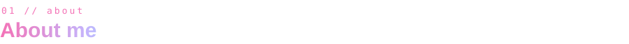

<table>
<tr>
<td width="60%" valign="top">

- 🎓 **Software Engineering** student at the *Faculté des Sciences de Tunis*
- ☁️ Specialising in **Cloud, DevOps & DevSecOps**
- 🛠️ DevOps intern — automating **Dynamics 365 CRM on-prem** delivery with **Azure DevOps Server**
- 🚀 **CMO @ CarthaPlay** — cloud + gamification for education
- 🧠 Background in **full-stack** (MERN, Spring Boot) and **deep learning**
- 🌍 Heading to **Germany in 2027** for a study exchange (DAAD)

</td>
<td width="40%" valign="top">

```yaml
now:
  building: CI/CD for on-prem CRM
  learning: K8s at scale, DevSecOps
  research: causal NLP on CVEs
ask_me_about:
  - pipelines that never break
  - cloud architecture on AWS
  - hackathons & tech community
fun_fact: I organise hackathons 🌙
```

</td>
</tr>
</table>


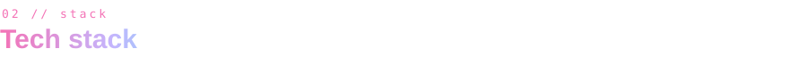

**☁️ Cloud & DevOps**
<p>
  
</p>

**💻 Development**
<p>
  
</p>

**🧠 AI / Data & tooling**
<p>
  
</p>

<p>
  
  
  
  
  
  
  
</p>


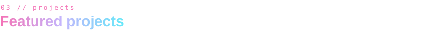

<p align="center">
  <!-- TODO: replace each href with the real repo URL -->
  <a href="https://github.com/roudayn-kouka/TODO-eks-repo"></a>
  <a href="https://github.com/roudayn-kouka/TODO-azdo-repo"></a>
</p>
<p align="center">
  
  <a href="https://github.com/roudayn-kouka/TODO-kan-ya-makan"></a>
</p>
<p align="center">
  <a href="https://github.com/roudayn-kouka/TODO-cve-repo"></a>
  <a href="https://github.com/roudayn-kouka/TODO-tutor-repo"></a>
</p>


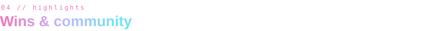

| | |
|:--|:--|
| 🏆 **Winner** — BH Assurance Hackathon | 🌙 **Lead Organizer** — Lunar Hack 2.0 |
| 🥇 **1st Place** — AI Night Challenge | 🎤 **Best Startup Pitch** — P2E-UTM |
| 🚀 **CMO** — CarthaPlay | 🤝 Big Tech Africa · Forum FST Digital · IEEE CS |


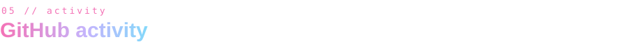

<p align="center">
  
  
</p>

<p align="center">
  
</p>

<p align="center">
  
</p>

<!-- Snake: generated by .github/workflows/snake.yml on the "output" branch -->
<p align="center">
  
</p>


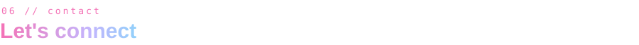

<p align="center">
  <a href="https://www.linkedin.com/in/TODO"></a>
  <a href="https://TODO-portfolio-url"></a>
  <a href="mailto:roudayna.kouka@etudiant-fst.utm.tn"></a>
  <a href="https://github.com/roudayn-kouka"></a>
</p>

<p align="center">
  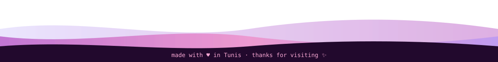
</p>
