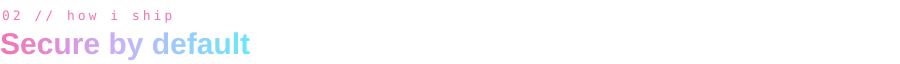
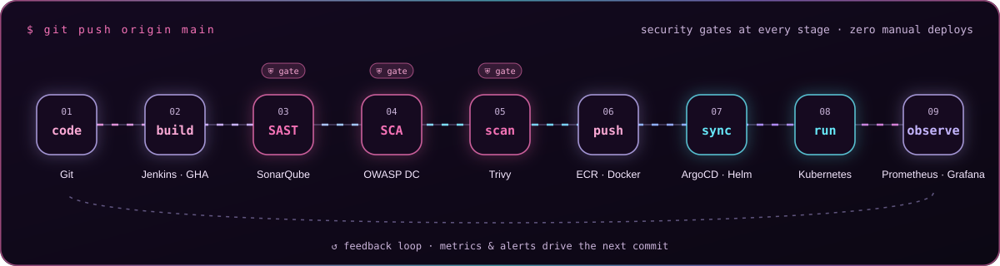

<p align="center">
  
</p>

<p align="center">
  <a href="https://roudayna-kouka-sigma-bay-44.vercel.app/">
    
  </a>
</p>

<p align="center">
  
  
  
</p>

<p align="center">
  
</p>


<table>
<tr>
<td width="58%" valign="top">

- ☁️ **Cloud, DevOps & DevSecOps engineer** in the making. I build **secure CI/CD pipelines**, **Infrastructure as Code** and **GitOps on Kubernetes** across **AWS, Azure and GCP**
- 🛡️ I put **security in the pipeline**: SAST, dependency checks, image scanning and policy-as-code before anything ships
- 🎓 Final-year **Software Engineering** student at the Faculty of Sciences of Tunis
- 🔬 **Cybersecurity NLP research**: causal relation extraction from CVE descriptions (BERT)
- 👩‍🏫 **DevOps instructor** at the IEEE CS Chapter FST
- 🚀 **Co-founder & CMO** of CarthaPlay (EdTech)
- 🌍 Open to remote work and relocation

</td>
<td width="42%" valign="top">

```yaml
apiVersion: v1
kind: Engineer
metadata:
  name: roudayna-kouka
  location: tunis-tn
spec:
  focus: [cloud, devops, devsecops]
  clouds: [aws, azure, gcp]
  principles:
    - automate everything
    - secure by default
    - observe, then improve
  languages: [ar, fr, en, de]
status:
  phase: open-to-work-2027
```

</td>
</tr>
</table>




<p align="center">
  
</p>


> **⚙️ DevOps & Software Engineering Intern · Inetum Tunisia** · *2026*
> Designed and deployed **3 Azure DevOps Server CI/CD pipelines** (Dynamics 365/Dataverse, data migration, .NET 8 API to IIS), **cutting deployment time by 40%** with fully offline, on-prem releases. Automated validation, packaging, backup, restore, health checks and **rollback**. Built an internal .NET 8 **CRM ALM dashboard** for deployment management and pipeline orchestration.
> `Azure DevOps Server` `YAML` `PowerShell` `.NET 8` `IIS` `SonarQube`

> **☁️ Cloud & DevOps Intern · PULSE** · *2026 · remote (U.S.)*
> Provisioned a **cloud-native data platform on GCP with Terraform**: BigQuery, Cloud Storage, Cloud Run, Cloud Scheduler, Artifact Registry, Secret Manager. Added CI/CD, **least-privilege IAM**, GCS lifecycle policies, Redis caching and **automated disaster recovery**.
> `GCP` `Terraform` `BigQuery` `Cloud Run` `IAM` `Secret Manager` `Redis`

> **🔬 Research Intern, Cybersecurity NLP · University of Tunis El Manar** · *2026 – present*
> NLP pipeline for event extraction, temporal ordering and **causal relation classification in CVE descriptions**. Annotated dataset of 383 CVEs, BERT-based classifier, manuscript in progress.
> `Python` `BERT` `NLP` `CVE/NVD` `Label Studio`


**☁️ Cloud & Infrastructure as Code**
<p>
  
</p>

**🔁 CI/CD, GitOps & Observability**
<p>
  
</p>
<p>
  
  
  
  
  
  
</p>

**🛡️ DevSecOps & Security**
<p>
  
  
  
  
  
  
</p>

**💻 Development & AI**
<p>
  
</p>


<p align="center">
  <a href="https://github.com/roudayn-kouka/devsecops"></a>
  <a href="https://github.com/roudayn-kouka/DevSecOps-project-netflix-"></a>
</p>
<p align="center">
  <a href="https://github.com/roudayn-kouka/azure-devops-pipeline"></a>
  <a href="https://github.com/roudayn-kouka/terraform-iac-devops"></a>
</p>
<p align="center">
  
  <a href="https://github.com/roudayn-kouka/devsecops-somple"></a>
</p>
<p align="center">
  <a href="https://github.com/roudayn-kouka/BH-Assurance"></a>
  <a href="https://github.com/roudayn-kouka/API-GraphQl-project"></a>
</p>

<details>
<summary><b>✨ More projects (AI, full-stack, Web3)</b></summary>
<br/>

| Project | What it is | Stack |
|:--|:--|:--|
| [Plant Disease Detection](https://github.com/roudayn-kouka/Traitement-d-image---ML---DL) | Classical ML vs CNN on PlantVillage, with a full-stack platform | Python · OpenCV · DL · MERN |
| [UniAssist AI](https://github.com/roudayn-kouka/uniassist-hub) | AI assistant for students | Gemini · LLMs |
| [ChainCert](https://github.com/roudayn-kouka/ChainCert) | Diploma verification on the blockchain | Ethereum · IPFS |
| [CarthaPlay](https://github.com/roudayn-kouka/Carthaplay3) | Learning games for children | React · JavaScript |
| [RoboKidLab](https://github.com/roudayn-kouka/robotkid-lab) | Educational robotics games | Web |

</details>


<p>
  
  
  
  
  
  
</p>


| 🏆 Awards | 🤝 Leadership & community |
|:--|:--|
| 🥇 **1st Place** · AI Night Challenge 2026 (ARSII) | 👩‍🏫 **DevOps Instructor** · IEEE CS Chapter FST |
| 🥇 **1st Place** · NEXT by BH Assurance hackathon 2026 | 🎙️ **Vice President** · ATIA Club FST |
| 🥇 **1st Place** · D-Clickathon 2026 (DAAL) | 🚀 **Co-founder & CMO** · CarthaPlay |
| | 🌙 **Lead Organizer** · Lunar Hack 2.0 |


<p align="center">
  
  
</p>

<p align="center">
  
</p>

<p align="center">
  <!-- Activity graph: generated by .github/workflows/snake.yml (scripts/activity_graph.py) on the "output" branch -->
  
</p>

<!-- Snake: generated by .github/workflows/snake.yml on the "output" branch -->
<p align="center">
  
</p>


<p align="center">
  <a href="https://roudayna-kouka-sigma-bay-44.vercel.app/"></a>
  <a href="https://www.linkedin.com/in/roudayna-kouka-10005a298"></a>
  <a href="mailto:roudayna.kouka@etudiant-fst.utm.tn"></a>
</p>

<p align="center">
  
</p>
